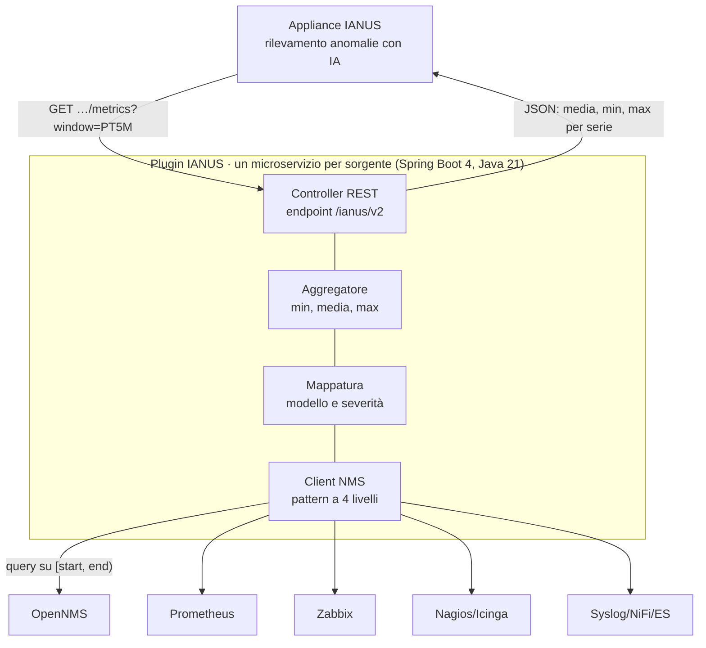

# IANUS – Architettura di Integrazione e Modello Dati

Versione 2.0 · 14 ottobre 2026 · Antonio Russo

## 1. Introduzione

La versione 2.0 definisce il contratto tra l'appliance IANUS e i plugin che raccolgono dati dai sistemi di Network Management (NMS). È il riferimento per lo sviluppo dei plugin previsto in OR8, attività A8.2 "Collettore Dati Rete", e sostituisce la versione del 9 dicembre 2025.

Due scelte guidano la revisione. La finestra temporale è indicata da IANUS nella richiesta (ultimi 5 minuti, ultima mezz'ora). Il plugin restituisce sempre dati sintetici: media, minimo e massimo di ogni serie nella finestra, mai i campioni grezzi.

| Tema | Versione 1.0 | Versione 2.0 |
| --- | --- | --- |
| Formato | Stringa `timestamp : metric : instance : value` | JSON; il carattere `:` resta libero dentro istanze e timestamp |
| Origine del dato | Non indicata (solo il tracciato log ha `server_id`) | Campi `source` e `node` obbligatori |
| Valore | Numerico o testuale nello stesso campo | Sempre numerico; gli attributi testuali vanno in `labels` |
| Unità di misura | Assente | Campo `unit` obbligatorio |
| Frequenza di raccolta | Non specificata | Finestra indicata nella richiesta (`window`) |
| Granularità | Campioni puntuali | Dati sintetici: media, minimo e massimo per finestra, con numero di campioni |
| Eventi | Singole occorrenze, senza messaggio | Conteggi per finestra, con messaggio di esempio |
| Severità | Scale diverse tra sezione 4 e 5 | Scala unica a 4 livelli e tabella di mappatura |
| Tracciato log | Colonne fisse (`cpu_usage`, `memory_usage`, …) | Ricondotto a metriche ed eventi |
| OpenAPI | Citato, non definito | Endpoint, parametri e risposte specificati |

## 2. Architettura a plugin

È IANUS a interrogare i plugin; ogni plugin interroga il proprio NMS sulla finestra richiesta e restituisce dati già mediati nel formato comune. Le responsabilità del plugin restano quelle della versione 1.0: dialogare con l'NMS, convertire i dati nel modello IANUS, isolare le logiche specifiche di ciascun sistema.



Verso l'NMS il plugin usa le API del sistema. Per le sorgenti che inviano dati al plugin (Syslog, trap SNMP) il plugin conserva quanto riceve per tutta la profondità storica dichiarata (sezione 8), così da poter rispondere su qualunque finestra. OpenNMS e Prometheus sono già realizzati (SAL4); Zabbix, Nagios Core/Icinga 2 e Syslog/NiFi/Elasticsearch sono da realizzare.

## 3. Richiesta dei dati: finestra temporale e aggregazione

Ogni richiesta di IANUS indica la finestra di osservazione; il plugin risponde, per ogni serie, con media, minimo e massimo su quella finestra. La frequenza di raccolta non è quindi una configurazione del plugin: è IANUS a decidere quando chiedere e su quale intervallo.

### 3.1 Parametri della richiesta

| Parametro | Obbligatorio | Formato | Significato |
| --- | --- | --- | --- |
| `window` | sì | Durata ISO 8601: `PT5M`, `PT30M` | Ampiezza della finestra. Ogni plugin deve supportare almeno 5 e 30 minuti |
| `end` | no | Istante RFC 3339 in UTC | Fine della finestra. Se assente: l'ultimo confine completo (vedi 3.2) |
| `node` | no | Stringa, ripetibile | Filtra i nodi monitorati |
| `metric` | no | Stringa, ripetibile | Filtra le metriche (solo endpoint metriche) |
| `page`, `size` | no | Interi | Paginazione della risposta |

### 3.2 Allineamento della finestra

Le finestre sono allineate a multipli della loro ampiezza. Con `window=PT5M` le finestre sono 10:00–10:05, 10:05–10:10 e così via; con `PT30M` sono 10:00–10:30, 10:30–11:00.

Senza `end`, il plugin usa l'ultima finestra conclusa: una richiesta alle 10:07 con `PT5M` restituisce 10:00–10:05. Così plugin diversi producono finestre identiche e i dati sono confrontabili tra sorgenti. Un `end` non allineato è rifiutato con errore 400.

La finestra comprende l'inizio ed esclude la fine: un campione delle 10:05:00 appartiene alla finestra 10:05–10:10.

### 3.3 Regole di aggregazione

1. **Grandezze istantanee** (gauge: CPU %, memoria %, temperatura): `value` è la media aritmetica dei campioni che cadono nella finestra; `min` e `max` sono il campione più basso e quello più alto.
2. **Contatori** (byte, pacchetti, errori su interfaccia): il plugin calcola prima il tasso per secondo tra campioni consecutivi, poi ne ricava media, minimo e massimo. Non si usa mai il valore grezzo di un contatore. Un azzeramento del contatore (riavvio, wrap a 32 bit) va scartato, non trasformato in un tasso negativo.
3. **Nessun campione nella finestra**: se la serie è nota al plugin, viene restituita con `value`, `min` e `max` a `null` e `samples: 0`. L'assenza di dati può essere essa stessa un segnale di anomalia e non deve sparire in silenzio.
4. **Eventi**: il dato sintetico è il conteggio delle occorrenze nella finestra (sezione 5).

Quando l'NMS sa già aggregare su un intervallo, il plugin usa la sua funzione invece di scaricare i campioni: per esempio la Measurements API di OpenNMS con aggregazione `AVERAGE`, `MIN` e `MAX`, oppure `avg_over_time`, `min_over_time`, `max_over_time` e `rate` in PromQL per Prometheus. Il risultato deve comunque rispettare le regole sopra.

## 4. Modello dati di performance

Una serie è identificata da `node`, `metric`, `instance` e `labels`; per ogni serie la risposta contiene media, minimo e massimo sulla finestra. La tupla della versione 1.0 resta riconoscibile: `timestamp` diventa la finestra, comune a tutta la risposta, e si aggiungono origine, unità e numero di campioni.

### 4.1 Campi della serie

| Campo | Tipo | Obbligatorio | Descrizione |
| --- | --- | --- | --- |
| `node` | stringa | sì | Oggetto monitorato che ospita la serie: hostname, IP o identificativo del nodo nell'NMS |
| `metric` | stringa | sì | Nome della metrica, in minuscolo con `_` (es. `cpu_usage`, `if_in_traffic`) |
| `instance` | stringa | sì | Istanza nel nodo: indice CPU, interfaccia, tupla NetFlow. Stringa vuota se la metrica è unica sul nodo |
| `unit` | stringa | sì | Unità dei valori: `percent`, `bytes_per_second`, `count`, `seconds`, `celsius`, … |
| `value` | numero o `null` | sì | Media nella finestra (sezione 3.3); `null` se non ci sono campioni |
| `min` | numero o `null` | sì | Valore minimo nella finestra; `null` se non ci sono campioni |
| `max` | numero o `null` | sì | Valore massimo nella finestra; `null` se non ci sono campioni |
| `samples` | intero | sì | Numero di campioni usati per il calcolo |
| `labels` | oggetto stringa→stringa | no | Attributi descrittivi della serie, anche testuali (programma, PID, VLAN) |

L'origine (`source`) e la finestra (`window`) stanno nell'intestazione della risposta (sezione 7) e valgono per tutte le serie.

### 4.2 Esempi

I tre esempi semplici della versione 1.0 diventano:

```json
[
  {"node": "srv-db-01", "metric": "cpu_usage", "instance": "1", "unit": "percent", "value": 40.2, "min": 31.0, "max": 58.5, "samples": 5},
  {"node": "srv-db-01", "metric": "cpu_usage", "instance": "2", "unit": "percent", "value": 50.0, "min": 44.1, "max": 61.3, "samples": 5},
  {"node": "router-core-1", "metric": "if_in_traffic", "instance": "Gigabit0/0", "unit": "bytes_per_second", "value": 209715200, "min": 157286400, "max": 262144000, "samples": 5}
]
```

Nell'esempio NetFlow, il programma e il PID erano valori testuali di metriche a sé stanti. Nella versione 2.0 diventano etichette della serie, perché di un testo non si può calcolare la media:

```json
{
  "node": "fw-edge-1",
  "metric": "tcp_connections_out",
  "instance": "192.168.0.1:222-212.151.3.2:446",
  "unit": "count",
  "value": 1,
  "min": 1,
  "max": 1,
  "samples": 5,
  "labels": {"program": "/hacker/trojan", "pid": "1234"}
}
```

### 4.3 Il tracciato log della versione 1.0

Il tracciato a colonne fisse della sezione 5 della versione 1.0 non è più un formato a parte. Ogni colonna diventa una metrica dello stesso nodo, così il modello resta puramente sintattico:

| Colonna v1.0 | Diventa |
| --- | --- |
| `server_id` | `node` |
| `cpu_usage` | metrica `cpu_usage`, unità `percent` |
| `memory_usage` | metrica `memory_usage`, unità `percent` |
| `disk_io` | metrica `disk_io`, unità `operations_per_second` |
| `network_traffic` | metrica `network_traffic`, unità `bytes_per_second` |
| `error_count` | conteggio eventi con severità `ERROR` o `CRITICAL` (sezione 5) |
| `log_level` | severità degli eventi (sezione 6) |

Se un algoritmo di IA ha bisogno della vista "una riga per server", IANUS la ricostruisce dalla risposta raggruppando per `node`.

## 5. Modello dati di evento

Anche gli eventi arrivano in forma sintetica: per ogni combinazione di `node`, `event_id`, `instance` e `severity` il plugin restituisce quante volte l'evento si è verificato nella finestra. Le sorgenti restano quelle della versione 1.0: Syslog, trap SNMP, eventi di fault degli NMS, eventi di sistema Windows e altre sorgenti strutturate.

### 5.1 Campi del gruppo di eventi

| Campo | Tipo | Obbligatorio | Descrizione |
| --- | --- | --- | --- |
| `node` | stringa | sì | Nodo che ha generato l'evento o a cui si riferisce |
| `event_id` | stringa | sì | Identificativo stabile del tipo di evento: UEI di OpenNMS, OID della trap, nome dell'alert, ID evento Windows |
| `instance` | stringa | sì | Oggetto coinvolto: interfaccia, servizio, processo. Stringa vuota se non applicabile |
| `severity` | stringa | sì | Severità normalizzata: `INFO`, `WARNING`, `ERROR`, `CRITICAL` (sezione 6) |
| `native_severity` | stringa | sì | Severità originale nell'NMS, conservata così com'è |
| `count` | intero | sì | Occorrenze nella finestra |
| `first_seen`, `last_seen` | istante RFC 3339 | sì | Prima e ultima occorrenza nella finestra |
| `message` | stringa | no | Testo dell'ultima occorrenza, come esempio leggibile |
| `labels` | oggetto stringa→stringa | no | Attributi aggiuntivi (facility Syslog, varbind della trap, …) |

Il messaggio non entra nella chiave di raggruppamento: messaggi che differiscono solo per un numero o un orario non devono generare gruppi diversi.

### 5.2 Esempio

```json
{
  "node": "router-core-1",
  "event_id": "uei.opennms.org/nodes/interfaceDown",
  "instance": "Gigabit0/1",
  "severity": "ERROR",
  "native_severity": "Major",
  "count": 3,
  "first_seen": "2026-10-14T10:01:12Z",
  "last_seen": "2026-10-14T10:04:48Z",
  "message": "Interface Gigabit0/1 is down"
}
```

## 6. Severità normalizzate

IANUS usa una sola scala a quattro livelli, che unisce quelle delle sezioni 4 e 5 della versione 1.0. Ogni plugin converte la severità nativa secondo la tabella seguente e la conserva in `native_severity`.

| Livello | Significato |
| --- | --- |
| `INFO` | Informazione o ritorno alla normalità |
| `WARNING` | Condizione anomala non critica |
| `ERROR` | Errore rilevante che richiede attenzione |
| `CRITICAL` | Condizione grave che impatta la continuità del servizio |

### 6.1 Mappatura dalle severità native

| Sorgente | INFO | WARNING | ERROR | CRITICAL |
| --- | --- | --- | --- | --- |
| OpenNMS | Indeterminate, Cleared, Normal | Warning, Minor | Major | Critical |
| Syslog (RFC 5424) | 5 Notice, 6 Informational, 7 Debug | 4 Warning | 3 Error | 0 Emergency, 1 Alert, 2 Critical |
| Zabbix | Not classified, Information | Warning | Average, High | Disaster |
| Nagios Core / Icinga 2 | OK, UP | WARNING, UNKNOWN | UNREACHABLE | CRITICAL, DOWN |
| Prometheus (etichetta `severity` degli alert) | info, none | warning, etichetta assente | error | critical |
| Eventi Windows | Information, Verbose, Audit Success | Warning | Error, Audit Failure | Critical |

Una severità nativa assente dalla tabella va trattata come `WARNING` e segnalata nel log del plugin.

## 7. Serializzazione e contratto OpenAPI

Tutti i plugin espongono gli stessi endpoint REST e rispondono in JSON con la stessa busta. Cambia solo il prefisso della sorgente: `opennms`, `prometheus`, `zabbix`, `icinga`, `syslog`.

### 7.1 Regole di formato

- Codifica UTF-8, `Content-Type: application/json`.
- Istanti in RFC 3339, sempre in UTC con suffisso `Z` (es. `2026-10-14T10:05:00Z`).
- Durate in ISO 8601 (`PT5M`, `PT30M`).
- Valori come numeri JSON, mai come stringhe; nomi dei campi in minuscolo con `_`.

### 7.2 Endpoint

| Metodo e percorso | Risposta |
| --- | --- |
| `GET /ianus/v2/{source}/metrics` | Serie di performance mediate sulla finestra (sezione 4) |
| `GET /ianus/v2/{source}/events` | Gruppi di eventi della finestra (sezione 5) |
| `GET /ianus/v2/{source}/capabilities` | Finestre supportate, metriche e nodi disponibili, profondità storica servibile |
| `GET /ianus/v2/health` | Stato del plugin e raggiungibilità di ciascun NMS configurato |

Gli endpoint attuali descritti nel SAL4 (`/ianus/opennms/metrics/all`, `/ianus/prometheus/targets`, …) restano disponibili durante la transizione ma non fanno parte del contratto v2. Ogni plugin pubblica la propria specifica OpenAPI 3, generata dal codice (per esempio con springdoc-openapi), e la specifica deve coincidere con questa sezione.

### 7.3 Busta della risposta

```json
{
  "source": {"system": "opennms", "id": "opennms-napoli-01", "plugin_version": "2.0.0"},
  "window": {"start": "2026-10-14T10:00:00Z", "end": "2026-10-14T10:05:00Z", "duration": "PT5M"},
  "complete": true,
  "page": {"number": 0, "size": 500, "total_elements": 1240},
  "metrics": [ { "node": "srv-db-01", "metric": "cpu_usage", "instance": "1", "unit": "percent", "value": 40.2, "min": 31.0, "max": 58.5, "samples": 5 } ]
}
```

Nell'endpoint eventi l'array si chiama `events`. `complete` vale `false` quando l'NMS ha risposto solo in parte (per esempio un poller remoto irraggiungibile); i dati restituiti restano validi.

### 7.4 Errori

| Codice | Quando |
| --- | --- |
| 400 | `window` non supportata, `end` non allineato o nel futuro, parametri non validi |
| 401 / 403 | API key assente o non valida |
| 404 | Sorgente non configurata nel plugin |
| 503 | NMS non raggiungibile: nessun dato restituito |

Il corpo dell'errore contiene almeno `code` e `message`.

## 8. Requisiti operativi dei plugin

La scheda OR8 chiede plugin resilienti e tolleranti alla perdita di connessione. Nel modello a richiesta questo si ottiene rendendo ogni finestra richiedibile anche dopo: se IANUS perde una o più chiamate, le ripete in seguito indicando `end`, e il plugin le serve finché l'NMS conserva i dati.

- **Profondità storica.** Il plugin dichiara in `capabilities` fino a quanto indietro può servire finestre. Il valore dipende dalla retention dell'NMS e va documentato per ogni installazione.
- **Idempotenza.** La stessa richiesta (sorgente, finestra, filtri) restituisce sempre lo stesso risultato, salvo dati arrivati in ritardo all'NMS.
- **Tempo.** Plugin e NMS devono essere sincronizzati via NTP. Il plugin converte in UTC ogni istante ricevuto dall'NMS.
- **Chiamate verso l'NMS.** Timeout configurabile, nuovi tentativi con attesa crescente, nessun blocco dell'intero plugin se un NMS non risponde.
- **Cache.** Il Collector schedulato con cache in memoria, già presente nel codice, può restare per le finestre recenti. Non sostituisce la capacità di servire una finestra passata su richiesta.
- **Sicurezza.** IANUS si autentica verso il plugin con una API key inviata nell'header HTTP X-API-Key; senza chiave o con chiave non valida il plugin risponde 401. Ogni installazione ha la propria chiave, sostituibile senza modificare il codice. Le credenziali verso l'NMS stanno nella configurazione o in un secret dell'orchestratore, mai nel codice.
- **Configurazione.** Per ogni sorgente: URL, credenziali, timeout, finestre supportate, filtri di default. In Spring Boot è una classe `@ConfigurationProperties`, come già avviene per OpenNMS e Prometheus.
- **Osservabilità.** Il plugin registra richieste, tempi di risposta dell'NMS, errori e severità non mappate; `/ianus/v2/health` riporta lo stato di ogni sorgente.
- **Distribuzione.** Ogni plugin è un microservizio containerizzato, distribuibile sull'orchestratore Kubernetes predisposto in A8.1.

## 9. Come sviluppare un nuovo plugin

Un nuovo plugin (Zabbix, Nagios/Icinga 2, Syslog/NiFi/Elasticsearch) replica il pattern a quattro livelli di IANUS Plugin e aggiunge i due componenti richiesti dalla versione 2.0: l'aggregatore e la mappatura delle severità.

1. **Properties.** Classe `@ConfigurationProperties` con URL, credenziali, timeout e finestre supportate della sorgente.
2. **Client Config.** Bean `RestClient` con base URL, autenticazione e timeout.
3. **REST Client / Handler.** Servizio `@Service` con le chiamate generiche e la gestione degli errori dell'NMS.
4. **API Classes + Models.** Classi che mappano gli endpoint dell'NMS e i relativi POJO Jackson.
5. **Aggregatore.** Dato un intervallo `[start, end)`, interroga l'NMS e calcola media, minimo e massimo di ogni serie secondo la sezione 3.3. Usa l'aggregazione dell'NMS quando esiste.
6. **Mappatura.** Converte nodi, nomi di metrica, unità ed eventi nel modello delle sezioni 4 e 5, e le severità secondo la sezione 6.
7. **Controller.** Espone gli endpoint della sezione 7 con il prefisso della sorgente.
8. **Test.** Almeno: allineamento delle finestre; media di gauge e contatori, incluso l'azzeramento del contatore; serie senza campioni; mappatura di tutte le severità native; risposta con NMS irraggiungibile.

### 9.1 Checklist di conformità

- [ ] `window=PT5M` e `window=PT30M` supportate
- [ ] Senza `end` viene restituita l'ultima finestra conclusa
- [ ] Ogni serie ha `node`, `metric`, `instance`, `unit`, `value`, `min`, `max`, `samples`
- [ ] Nessun valore testuale in `value`, `min`, `max`
- [ ] Contatori convertiti in tassi prima del calcolo di media, minimo e massimo
- [ ] Eventi raggruppati con `count`, `first_seen`, `last_seen`
- [ ] Severità normalizzata e severità nativa presenti
- [ ] Istanti in UTC con suffisso `Z`
- [ ] API key verificata su ogni endpoint
- [ ] Specifica OpenAPI pubblicata e coerente con la sezione 7
- [ ] `capabilities` e `health` implementati

## 10. Principi del modello e questioni aperte

Il modello resta puramente sintattico, come nella versione 1.0: nessuna ontologia, nessuna semantica proprietaria degli NMS. Gli algoritmi di IA possono così pesare qualunque metrica senza dipendere dal sistema di origine. La versione 2.0 aggiunge tre garanzie: ogni dato dice da dove viene e in che unità è espresso; tutti i plugin producono finestre identiche e confrontabili; il dato è sempre sintetico, quindi il volume verso IANUS dipende dal numero di serie e non dalla frequenza di campionamento degli NMS.

### 10.1 Questioni aperte

- [ ] Finestre oltre 5 e 30 minuti (per esempio 1 ora) da rendere obbligatorie?
